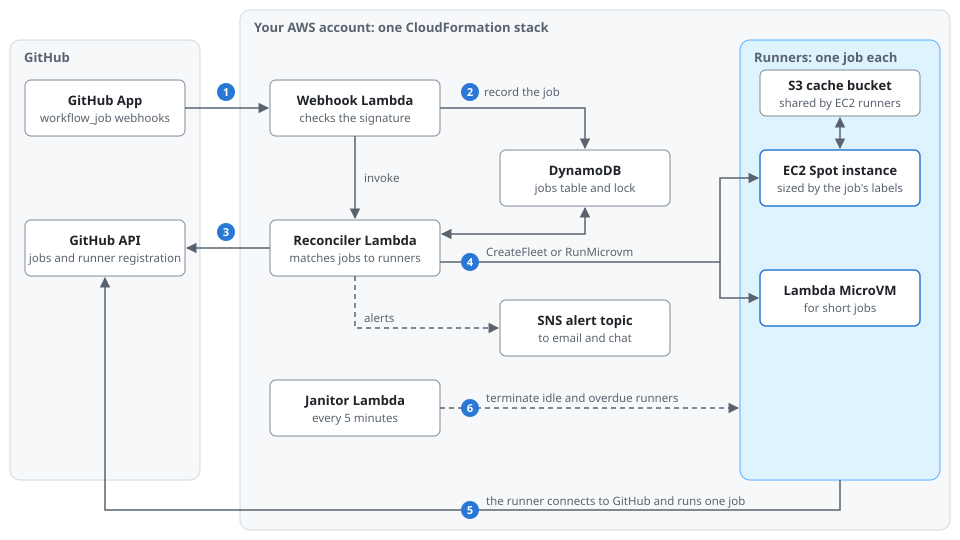
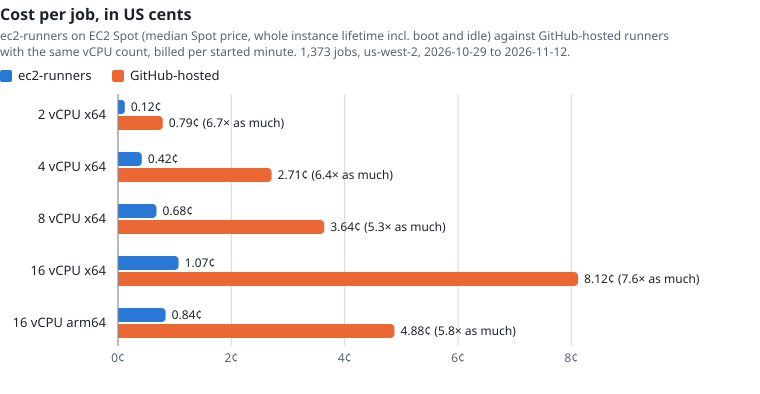

# ec2-runners

Ephemeral self-hosted GitHub Actions runners for a GitHub organization, on EC2 Spot and AWS Lambda MicroVMs in your own AWS account. The whole system is one CloudFormation stack: three Lambda functions, a DynamoDB table, a VPC, and an S3 cache bucket.

A job opts in with a label. A job that asks for `ec2` gets a fresh EC2 instance sized from its labels, and a job that asks for `microvm` gets a Lambda MicroVM. A MicroVM job starts about 15 seconds after it is queued and an EC2 job about 37 seconds after, at the median. Each runner runs one job and terminates itself.



```yaml
jobs:
  test:
    runs-on: [ec2, cpu=8, ram=32]      # an 8 vCPU Spot instance with at least 32 GiB
    steps:
      - uses: actions/checkout@v6
      - run: make test

  changes:
    runs-on: microvm                   # a small ARM64 MicroVM for a short job
    steps:
      - run: gh pr view ${{ github.event.number }} --repo "$GITHUB_REPOSITORY" --json files
        env:
          GH_TOKEN: ${{ github.token }}
```

## Features

- **Sized per job.** `cpu=`, `ram=`, `family=`, `disk=`, and `image=` labels pick the instance through EC2's attribute-based selection, across three availability zones, with Spot first and On-Demand as the fallback.
- **One job per runner.** Each runner registers with a just-in-time config for a single job and is deleted afterwards, so no state carries over between jobs.
- **A pooled reconciler.** Queued jobs are matched to idle runners before anything launches, so a job that took another job's runner does not leave either waiting. Runners for cancelled jobs are retired right away.
- **Recovery from missed webhooks.** A scheduled reconcile finds queued jobs whose webhook never arrived and launches for them within about 5 minutes.
- **Fast caches.** An S3 bucket backs [`runs-on/cache`](https://github.com/runs-on/cache) and the BuildKit layer cache, and `nvme=true` puts Docker and the workspace on local NVMe disks.
- **Alerts.** Labels that can never launch, launches that keep failing, misconfigured runner groups, and Lambda errors go to an SNS topic, formatted for chat channels connected through Amazon Q Developer.
- **Serverless control plane.** The webhook, reconciler, and janitor are Lambda functions with state in DynamoDB, so the stack has no instances of its own to patch. The VPC has no NAT gateway, and runners accept no inbound connections.

## Cost

Over two weeks of one organization's CI, EC2 Spot runners cost 5 to 8 times less per job than GitHub-hosted runners with the same vCPU count, counting each instance's boot and idle time. [docs/benchmarks.md](docs/benchmarks.md) has the method, start times, and MicroVM costs.



## Runner images

Runners use the public Ubuntu images that [RunsOn](https://runs-on.com) publishes as ports of GitHub's hosted runner images, so actions that work on `ubuntu-latest` generally work here. You can point the stack at your own AMIs.

## Getting started

```bash
bun install
AWS_PROFILE=my-account ./deploy.sh GitHubOrg=my-org AlertEmail=you@example.com
```

Then create a GitHub App that sends `workflow_job` webhooks to the stack, and store its credentials in the stack's secret. [docs/setup.md](docs/setup.md) has every step.

Coding agents can run the setup with the `setup-ec2-runners` skill in [`.agents/skills`](.agents/skills), which Claude Code also reads through `.claude/skills`.

## Documentation

- [Setup](docs/setup.md): deploying, the GitHub App, alerts, quotas, parameters, updating, and removing the stack.
- [Usage](docs/usage.md): `runs-on` labels, the job environment, the cache bucket, MicroVM runners, and Docker builds.
- [Operations](docs/operations.md): alerts and what to do about them, logs, debugging a job that stays queued, and known limits.
- [Architecture](docs/architecture.md): how a queued job becomes a runner, the runner pool, and the source layout.
- [Benchmarks](docs/benchmarks.md): measured start times and cost per job against GitHub-hosted runners.
- [Contributing](CONTRIBUTING.md) and [Security](SECURITY.md).

## Agent skills

| Skill | Use it to |
| --- | --- |
| [`setup-ec2-runners`](.agents/skills/setup-ec2-runners/SKILL.md) | Deploy the stack to an AWS account and connect it to a GitHub organization. |
| [`debug-ec2-runners`](.agents/skills/debug-ec2-runners/SKILL.md) | Find out why a job is still queued, a runner failed, or an alert fired. |
| [`adopt-ec2-runners`](.agents/skills/adopt-ec2-runners/SKILL.md) | Move a repository's workflow jobs onto `ec2` and `microvm` runners. |

Agents working in a clone of this repository load the skills from `.agents/skills` (Codex and other Agent Skills hosts) or `.claude/skills` (Claude Code). To use them from any project in Claude Code, install the plugin from this repository's marketplace:

```
/plugin marketplace add Fountain-Bio/ec2-runners
/plugin install ec2-runners@ec2-runners
```

The skills then run as `/ec2-runners:setup-ec2-runners`, `/ec2-runners:debug-ec2-runners`, and `/ec2-runners:adopt-ec2-runners`. The setup skill clones this repository to deploy from, since later updates are deployed from the same checkout.

## License

[MIT](LICENSE)
