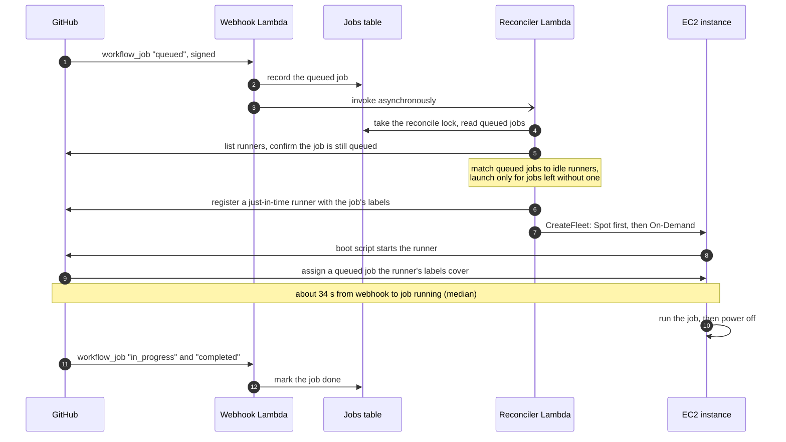

# Architecture

ec2-runners is one CloudFormation stack (`template.yaml`) with three Lambda functions, a DynamoDB table, and the network, IAM roles, buckets, and alarms they need. This page explains how a queued GitHub Actions job becomes a runner, and why the reconciler is built the way it is.

## How a job gets a runner

The numbered arrows in the diagram:

1. GitHub sends the GitHub App's `workflow_job` webhook to the Webhook Lambda.
2. The Webhook Lambda records the queued job in the jobs table and invokes the reconciler.
3. The reconciler confirms with the GitHub API that the job is still queued and registers a just-in-time runner.
4. The reconciler launches an EC2 Spot instance or a Lambda MicroVM for the runner.
5. The runner connects to GitHub, which assigns it a queued job its labels cover. It runs that one job and shuts down.
6. Every 5 minutes, the janitor terminates runners that sat idle too long or ran past `MaxMinutes`.

The same steps for one EC2 job, in order:

In detail:

1. GitHub sends a `workflow_job` webhook to a Lambda function URL (`<stack>-webhook`). The function checks the HMAC signature and keeps only jobs whose labels include `ec2` or `microvm`. It records each queued job from a private repository in a DynamoDB table (`<stack>-jobs`), marks jobs done when they start or finish, and invokes the reconciler asynchronously.
2. The reconciler (`<stack>-reconciler`) compares the queued jobs with the runners that could still take them: registered, idle, and either running or still launching. It launches a runner for each job those runners cannot cover. Before launching, it confirms with the GitHub API that the job is still queued, finds the newest matching AMI, and checks that some instance type matches the labels. It then registers a just-in-time runner with the job's labels and calls EC2 Fleet (`instant`) with attribute-based instance selection, one subnet per call in shuffled order, trying Spot with `price-capacity-optimized` in each subnet first, then On-Demand. A `microvm` job gets a Lambda MicroVM instead (see [MicroVM runners](#microvm-runners)).
3. The instance boot script runs `run.sh --jitconfig`, executes the job, and powers off. The launch template sets shutdown behavior to `terminate`, so power-off deletes the instance.
4. The janitor (`<stack>-janitor`, every 5 minutes) terminates instances that have not started a job within `IdleMinutes` or have run longer than `MaxMinutes`, removes runner registrations whose instance has ended or never appeared, and deletes launch template versions left by a reconciler that stopped partway.

The same 5-minute schedule also runs the reconciler. A scheduled reconcile retries launches that still failed after a reconcile's own retries, replaces runners the janitor terminated for still-queued jobs, and catches up on reconciles that the webhook could not invoke.

GitHub sometimes never sends a job's `queued` webhook, and a delivery can also fail, which leaves the job out of the jobs table. Before each scheduled reconcile, the reconciler therefore lists the queued jobs in the workflow runs of the last 24 hours in every private repository the GitHub App can access (public ones too when `AllowPublicRepos` is true), and records those with the `ec2` or `microvm` label that the table lacks. Such a job waits at most about 5 minutes for its runner. The reconciler's log records each one as `recorded queued jobs whose webhook never arrived`.

## The runner pool

GitHub gives a queued job to any idle runner whose labels include all of the job's labels. GitHub does not know which job a runner was launched for, so a job that asks for `[ec2]` can start on a runner launched for a job that asked for `[ec2, cpu=8]`. The reconciler therefore treats the stack's runners as one pool. On every run it pairs queued jobs with available runners using a maximum bipartite matching (`src/pool.ts`), and launches only for the jobs left without a runner. Two jobs that each take the other's runner need no launch. A `cpu=8` job whose runner went to an `[ec2]` job gets a new runner, because the `[ec2]` job's runner does not fit it.

The matching also shows which idle runners no queued job needs. A running one whose own job has started elsewhere, finished, or been cancelled is retired right away, which matters for repositories whose CI cancels superseded runs. The janitor's `IdleMinutes` limit is the backstop for runners the reconciler did not retire.

Runner names are `<stack>-<job id>-<launch time>`. The job ID shows which job the launch was for, and the launch time lets the janitor remove a registration that never got an instance. The name records the job a runner was launched for, which can differ from the job it runs.

## Serialized reconciles

Reconciles never overlap. Each pass holds a lock item in the jobs table (`jobId` 0, `src/lock.ts`). An invocation that finds the lock held records a request and exits, and the holder runs one more pass for each request before releasing the lock. Each pass therefore sees the runners the previous pass registered, so two reconciles do not launch for the same job. A holder that crashes keeps the lock only until 30 seconds past the reconciler's Lambda timeout.

A job can still get a second runner in a narrow window: GitHub marks a runner busy a moment before the job's status changes, and a reconcile in between sees the job queued with no free runner. The spare runner serves the next queued job that fits it, or the janitor terminates it after `IdleMinutes`.

One reconcile launches all uncovered jobs in parallel, so a burst of queued jobs does not wait on a line of separate runs. A failed launch is retried 30 seconds later, up to 6 passes per invocation, and the 5-minute schedule picks the job up after that.

## MicroVM runners

A job labelled `microvm` runs in an AWS Lambda MicroVM: a Firecracker VM that Lambda starts from a snapshot of the stack's MicroVM image (`src/microvm.ts`, `src/microvm-image.ts`).

- **Image.** The janitor builds the image `<stack>-runner` on its first run after the GitHub App's credentials are stored and the app is installed, which takes about three minutes. It rebuilds the image when the actions runner, gh, Node.js LTS, or Bun release changes, when the image source in `src/microvm-image.ts` or `MicrovmMemoryMiB` changes, and when the image is 30 days old, which keeps it ahead of Lambda's base image deprecations. Lambda builds it from a zip that the janitor writes to a bucket that runners cannot write to, so no job can change what later MicroVM runners run. The janitor deletes image versions once no MicroVM can still be running on them.
- **Launch.** The reconciler registers a just-in-time runner and calls `RunMicrovm`, passing the gzipped JIT config to the image's `/run` hook, which starts the runner. RunMicrovm limits that payload to 4,096 characters, and an encoded JIT config is about 4,100, hence the gzip. The MicroVM accepts no inbound connections and has no idle policy, since Lambda measures idleness by inbound traffic, which a runner never gets. When the runner exits after its job, the container exits and Lambda terminates the MicroVM. Lambda also terminates it after `MaxMinutes`.
- **Pool.** MicroVMs have no tags, so after the launch the reconciler adds a `microvm-id=<id>` label to the runner's GitHub registration, and the reconciler and janitor read that label to find an idle runner's MicroVM. MicroVM runners join the same pool as EC2 runners: a spare one is retired, an idle one is terminated after `IdleMinutes`, and a registration whose MicroVM ended is removed.
- **Fallback to EC2.** When a MicroVM does not launch, because the account's MicroVM memory quota is full, the image is still building, or the service fails, the reconciler launches an EC2 runner for the job instead, of the default size and image and with the job's labels, so it can take the `microvm` job. The reconciler's log records each one as `MicroVM launch failed, launching an EC2 runner instead`.

## Network and access

The stack creates its own VPC with three public subnets and no NAT gateway. The runner security group has no inbound rules. An S3 gateway endpoint keeps cache traffic on the AWS network.

Each EC2 runner's instance profile can read and write the cache bucket, write its boot log to CloudWatch Logs, and register with Session Manager for shell access while the instance runs. The instance metadata service requires IMDSv2 tokens, with a hop limit of 2 so Docker containers in a job can reach the instance credentials. MicroVM runners get no AWS credentials.

The webhook function URL is public (`AuthType: NONE`), since GitHub must reach it. The function rejects any delivery whose HMAC signature does not match the webhook secret, and a CloudWatch alarm fires when several deliveries fail that check.

## Source layout

| File | Role |
| --- | --- |
| `src/webhook.ts` | Webhook handler: verifies signatures, records queued jobs, invokes the reconciler. |
| `src/reconciler.ts` | Reconciler handler: backfills missed jobs, matches jobs to runners, launches and retires runners. |
| `src/janitor.ts` | Janitor handler: enforces `IdleMinutes` and `MaxMinutes`, removes stale registrations, builds the MicroVM image. |
| `src/pool.ts` | The bipartite matching between queued jobs and available runners. |
| `src/jobs.ts`, `src/lock.ts` | The jobs table and the reconcile lock stored in it. |
| `src/labels.ts` | Parses `runs-on` labels into instance requirements. |
| `src/ec2.ts`, `src/userdata.ts` | EC2 Fleet launches and the instance boot script. |
| `src/microvm.ts`, `src/microvm-image.ts` | MicroVM launches and the MicroVM image source. |
| `src/github.ts`, `src/app-secret.ts` | GitHub App authentication and API calls. |
| `src/alerts.ts` | Publishes alerts to the SNS topic. |
| `src/config.ts` | Zod schemas for each handler's environment variables. |
| `scripts/create-github-app.ts` | Registers the GitHub App from a manifest and stores its credentials (setup steps 2 and 3). |
| `actions/docker-cache` | Composite action that gives a Docker build its BuildKit cache settings. |
