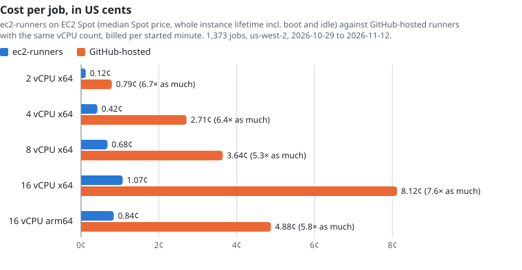

# Benchmarks

These numbers come from one production deployment: the CI of a TypeScript monorepo and a few smaller repositories in one GitHub organization, with the stack in us-west-2. They show how long each runner type takes to start a job, where that time goes, and what the runners cost next to GitHub-hosted runners. Treat them as one organization's measurements, not a controlled benchmark: the workloads changed during the window, and caches were sometimes cold.

## Data

| Source | Window | Sample |
| --- | --- | --- |
| GitHub Actions API: each job's queued, started, and completed times and its steps | 2026-09-24 to 2026-11-12 | 7,216 jobs that started, in 3,315 workflow runs |
| The stack's CloudWatch logs: webhook receipts, reconciler launches, EC2 boot logs, MicroVM logs | 2026-10-29 to 2026-11-12 | 1,515 EC2 launches, 293 MicroVM launches |
| EC2 Spot price history and the AWS Price List API, us-west-2 | the same 14 days | the 47 instance types the reconciler launched |

MicroVM runners went live on 2026-11-11, so their rows cover two days. Prices are list prices in November 2026.

## Time to start a job

Queue time is the time from GitHub queuing a job to the job starting on a runner, as GitHub's API reports it.

| Runner | Jobs | p50 | p90 | p99 |
| --- | --- | --- | --- | --- |
| GitHub-hosted (`ubuntu-latest`) | 3,709 | 3 s | 4 s | 6 s |
| A third-party hosted runner service, 4 and 8 vCPU | 435 | 10 s | 20 s | 47 to 64 s |
| ec2-runners `microvm` | 257 | 15 s | 20 s | 24 s |
| ec2-runners `ec2`, all sizes | 2,799 | 37 s | 59 s | 230 s |
| `ec2, cpu=2` | 47 | 38 s | 61 s | 158 s |
| `ec2, cpu=8, nvme=true` | 1,176 | 38 s | 61 s | 218 s |
| `ec2, cpu=16, nvme=true` on arm64 | 421 | 31 s | 58 s | 299 s |

GitHub-hosted runners start fastest because GitHub keeps a warm pool. An ec2-runners runner is created for the job, so its start time is a launch and a boot. Instance size makes little difference.

### Where an EC2 runner's start time goes

From the stack's logs, per launch (1,374 runners):

| Phase | p50 | p90 |
| --- | --- | --- |
| Webhook received → EC2 Fleet launch returned | 9.0 s | 54 s |
| Launch returned → kernel started | 4.5 s | 5.4 s |
| Kernel started → boot script started | 6.2 s | 7.6 s |
| Boot script started → runner listening | 10.5 s | 14.4 s |
| Runner listening → job running | 2.0 s | 3.0 s |
| **Webhook received → job running** | **34 s** | **85 s** |

Inside the boot script, the actions runner download, checksum, and extraction take 5.2 s at the median, and Docker starts in parallel in 7.9 s. 97% of these runners used local NVMe disks.

The slow tail came from the reconcile, not the boot. The account's Spot vCPU quota was 256 when the window began, and bursts of parallel jobs hit it: 53 launches failed with `MaxSpotInstanceCountExceeded` and were retried, each retry 30 seconds later, the last on 2026-11-05. The quota is now 512, twice the peak of 272 Spot vCPUs the runners reached, and no launch has failed on it since. The table splits the launches at 2026-11-06:

| Webhook received → job running | Quota 256 (680 launches) | Quota 512 (825 launches) |
| --- | --- | --- |
| p50 | 39 s | 32 s |
| p90 | 152 s | 42 s |
| Launches retried for the Spot quota | 53 | 0 |

Size the Spot vCPU quota above your CI's peak concurrency; see [Account quotas](setup.md#account-quotas). Launch returned to runner listening, the boot itself, is 21 s at the median and 27 s at p90.

### Where a MicroVM runner's start time goes

Per launch (289 MicroVMs):

| Phase | p50 | p90 |
| --- | --- | --- |
| Webhook received → `RunMicrovm` returned | 5.3 s | 13.7 s |
| `RunMicrovm` returned → the image's `/run` hook called | 0.4 s | 0.9 s |
| `/run` hook → runner listening | 4.1 s | 7.4 s |
| Runner listening → job running | 2.3 s | 2.5 s |
| **Webhook received → job running** | **12.8 s** | **17.9 s** |

Lambda starts each MicroVM from a snapshot of the image and calls its `/run` hook 0.4 s after `RunMicrovm` returns. Most of the remaining time is the actions runner connecting to GitHub, and the reconcile before the launch. 2 of 295 MicroVM launch attempts fell back to EC2 runners.

## What it means for job duration

The same jobs before and after a change of runner, median of queue time plus run time:

| Job | Before | After |
| --- | --- | --- |
| Path filter (a few seconds of work) | GitHub-hosted: 7 s | `microvm`: 22 s |
| CI status gate | GitHub-hosted: 6 s | `microvm`: 18 s |
| AI code review | GitHub-hosted: 58 s | `microvm`: 76 s |
| Unit tests, x64 to arm64 at 16 vCPU | `ec2` x64: 104 s | `ec2` arm64: 98 s |
| Backend Docker image build step alone, 4 vCPU | third-party service: 29 s | `ec2, nvme=true`: 51 s without a layer cache; 15 s with the [S3 layer cache](usage.md#buildkit-layer-cache-in-s3) |

For jobs that finish in seconds, GitHub-hosted runners are faster than either ec2-runners runner type, because start time dominates. MicroVM runners start 20 to 25 seconds sooner than EC2 runners, which makes them the better ec2-runners choice for short jobs, but they do not match GitHub's warm pool. Jobs that run for minutes, need more than 2 vCPUs, or build images gain more from the larger instances and local disks than they lose at start.

### Docker layer cache

An experiment built the same backend image four times per configuration on a fresh BuildKit builder, so the S3 cache was the only cache. Times are the whole build, in seconds:

| Cache configuration | Cold | Unchanged | Source change | Dependency manifest change |
| --- | --- | --- | --- | --- |
| `mode=max`, gzip | 118 | 3.7 | 76 | 104 |
| `mode=min`, gzip | 81 | 3.9 | 69 | 68 |
| `mode=max`, zstd | 101 | 4.1 | 97 | 89 |
| `mode=max`, Dockerfile reordered for caching | 127 | 3.7 | 23 | 121 |
| `mode=min`, Dockerfile reordered for caching | 84 | 3.6 | 26 | 63 |

`mode=max` spends about 60 seconds exporting every stage's layers on a cold or dependency-changing build, and pays that back only when intermediate stages are expensive to rebuild. Ordering the Dockerfile so that source changes invalidate the fewest layers mattered more than any cache setting.

## Cost

### Rates

| Runner | Rate | Billing |
| --- | --- | --- |
| GitHub-hosted Linux, 1 vCPU (`ubuntu-slim`) | $0.002 per minute | each job rounded up to a whole minute |
| GitHub-hosted Linux, 2 vCPU x64 (`ubuntu-latest`) | $0.006 per minute | rounded up to a whole minute |
| GitHub-hosted larger runners, 4 / 8 / 16 vCPU x64 | $0.012 / $0.022 / $0.042 per minute | rounded up to a whole minute |
| GitHub-hosted larger runners, 4 / 8 / 16 vCPU arm64 | $0.008 / $0.014 / $0.026 per minute | rounded up to a whole minute |
| EC2 instance | the instance type's Spot or On-Demand price | per second, 60-second minimum |
| Lambda MicroVM, 1 vCPU and 2 GiB baseline (ARM) | $0.0021 per minute | per second, plus $0.00155 per GB of snapshot read at each launch |

GitHub's included minutes cover standard GitHub-hosted runners up to a monthly dollar amount that depends on the plan. GitHub charges nothing for self-hosted runner minutes; it announced a $0.002 per minute platform charge for them in December 2025 and postponed it with no new date.

Spot prices for the instance types launched most often, median over the 14 days in us-west-2:

| Instance type | vCPU | Memory | Launches | Spot $/hour | On-Demand $/hour | Spot discount |
| --- | --- | --- | --- | --- | --- | --- |
| z1d.2xlarge | 8 | 64 GiB | 260 | 0.241 | 0.744 | 68% |
| c8gd.4xlarge (arm64) | 16 | 32 GiB | 241 | 0.303 | 0.784 | 61% |
| m8gd.4xlarge (arm64) | 16 | 64 GiB | 208 | 0.288 | 0.923 | 69% |
| m8id.2xlarge | 8 | 32 GiB | 173 | 0.170 | 0.522 | 68% |
| c8id.4xlarge | 16 | 32 GiB | 143 | 0.322 | 0.887 | 64% |
| i4i.2xlarge | 8 | 64 GiB | 99 | 0.267 | 0.686 | 61% |

Almost every job asked for local NVMe disks (`nvme=true`), so these are the cheapest NVMe types that matched each job's labels at launch. 94% of launches got Spot capacity; the rest fell back to On-Demand.

### Cost per job

Each EC2 runner's cost is its whole lifetime, from launch to power-off, so it includes the boot and any idle time, at the median Spot price of its type (or the On-Demand price for On-Demand launches), plus its 40 GiB gp3 volume and public IPv4 address. The GitHub-hosted column prices the same job's run time on the GitHub-hosted runner with the same vCPU count and architecture, rounded up to whole minutes.

| Runner size | Jobs | ec2-runners per job | GitHub-hosted per job | GitHub-hosted ÷ ec2-runners |
| --- | --- | --- | --- | --- |
| 2 vCPU x64 | 19 | $0.0012 | $0.0079 | 6.7× |
| 4 vCPU x64 | 157 | $0.0042 | $0.0271 | 6.4× |
| 8 vCPU x64 | 595 | $0.0068 | $0.0364 | 5.3× |
| 16 vCPU x64 | 181 | $0.0107 | $0.0812 | 7.6× |
| 16 vCPU arm64 | 420 | $0.0084 | $0.0488 | 5.8× |
| **All EC2 jobs**, including one 4 vCPU arm64 job | **1,373** | **$10.23 total** | **$61.28 total** | **6.0×** |

The instances ran 2,280 minutes for 1,634 minutes of jobs: boot, shutdown, and idle time add about 40%. Priced at On-Demand instead of Spot, the same runners would have cost $26.47, still 2.3× less than GitHub-hosted runners of the same size.

MicroVM jobs in this sample were short: 11 seconds of job at the median, and 19 seconds of MicroVM lifetime. Their compute cost $0.0012 per job. The snapshot read at launch adds $0.0016 to $0.0062 per job, for a snapshot of 1 to 4 GB; AWS bills the memory and disk the snapshot uses, which the API does not report, so this range is an estimate. That puts a MicroVM job at $0.003 to $0.007, against $0.0074 for the same jobs on `ubuntu-latest` and $0.0025 on `ubuntu-slim`, both after rounding up to a minute. For jobs this short, MicroVM runners cost about the same as GitHub-hosted runners.

## Summary

- **Short jobs** (seconds of work, no Docker): GitHub-hosted runners start fastest, and their cost is comparable. Use `microvm` for short jobs that must run in your AWS account, or when GitHub-hosted minutes are exhausted.
- **Jobs of a minute or more, or that need more than 2 vCPUs**: EC2 Spot runners cost 5 to 8 times less than GitHub-hosted runners of the same size, and the 30 to 40 seconds of start time is a smaller share of the job.
- **Docker builds**: use `nvme=true` and the S3 layer cache. Without the cache, a fresh EC2 runner rebuilds every layer.
- **Bursts**: keep the Spot vCPU quota above peak concurrency. A quota at the peak tripled this deployment's p90 start time.
